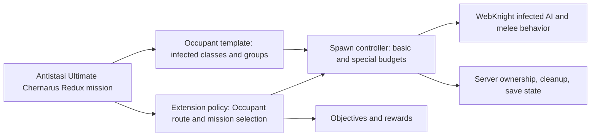

# Antistasi Ultimate × WebKnight Zombies and Creatures
## Product plan and Scrum backlog

**Planning baseline:** 3 November 2026. **Status:** research and planning; no extension has been built or playtested in this workspace. **Launch terrain:** Chernarus Redux, using Antistasi Ultimate's existing `Antistasi_chernarusredux.chernarusredux` mission. **Product owner decision:** infected replace the **Occupant** role. Russian Invaders, survivor civilians, survivor gang Rivals, and NATO Rebels are existing campaign choices; changing their faction templates is outside this project's scope. Their interactions with the infected remain integration test cases.

## Product goal and boundaries

Deliver a separately identifiable Antistasi Ultimate extension that selects WebKnight infected as Occupants and makes an outbreak campaign work from first spawn through late campaign, including territory ownership, garrisons, missions, attacks, reinforcement, special infected pacing, multiplayer, saving, and cleanup. Preserve the selected non-Occupant faction templates. Treat the attached [mission statement](MISSION_STATEMENT.md) as the requirements source, not as instructions to the assistant.

**Release success:** a new Chernarus Redux campaign starts with the infected Occupant selected; occupied locations contain valid infected forces; capturing, losing, saving, and reloading locations works; no Occupant mission depends on an infected driver, gunner, pilot, prisoner, radio operator, or conventional weapon use without a deliberate alternative; basic and special infected follow documented rules; local host and dedicated multiplayer sessions complete the critical scenarios without script errors or runaway spawns.

**Scope boundary:** This is an Occupant integration and mission compatibility project. The existing choices for Invaders, Civilians, Rivals, and Rebels are inputs to integration tests. Any change to their templates needs a separate product decision. Chernarus Redux map support exists upstream; this project only changes terrain data if tests reveal a specific outbreak related map defect.

## Research findings and engineering implications

| Source finding | Implication for this project |
| --- | --- |
| Ultimate registers faction templates with `requiredAddons[]`, `side = "Occ"`, paths and a template SQF. Its own example warns extender authors to use the [Ultimate Blank Extender Template](https://github.com/Antistasi-Ultimate-Community/a3ue-blank-template) or fix paths. [Ultimate example](https://github.com/Antistasi-Ultimate-Community/A3-Antistasi-Ultimate/blob/a0bffed/A3A/addons/core/Templates/Templates/%23Examples/templates.hpp), [warning](https://github.com/Antistasi-Ultimate-Community/A3-Antistasi-Ultimate/blob/a0bffed/A3A/addons/core/Templates/Templates/%23Examples/readme.md), [blank template guide](https://github.com/Antistasi-Ultimate-Community/a3ue-blank-template/blob/dev/%40a3uebet/addons/example_faction/README.md) | Start with a separate extender and a single `Occ` template. Pin the exact Ultimate build used for development. Verify loaded class names and paths in game. |
| Ultimate's existing `Vanilla_Civ_Zombie` is a **Civ** template with `attributeCivNonHuman`; it is not an Occupant faction. It uses WebKnight classes including walkers, shamblers, screamers, and leapers. [Template registration](https://github.com/Antistasi-Ultimate-Community/A3-Antistasi-Ultimate/blob/a0bffed/A3A/addons/core/Templates/Templates/Misc/templates.hpp), [template script](https://github.com/Antistasi-Ultimate-Community/A3-Antistasi-Ultimate/blob/a0bffed/A3A/addons/core/Templates/Templates/Misc/Vanilla_Civ_Zombie.sqf) | Do not select the civilian zombie template: the requested civilians are survivors. Use it only as a reference for known class names and test each class against the installed WebKnight build. |
| Ultimate's new game garrison initialization fills Occupant sites from tiered squad and medium group arrays; its preference and line selectors also ask for vehicles and crew. [New game garrisons](https://github.com/Antistasi-Ultimate-Community/A3-Antistasi-Ultimate/blob/a0bffed/A3A/addons/core/functions/init/fn_initGarrisons.sqf), [preferences](https://github.com/Antistasi-Ultimate-Community/A3-Antistasi-Ultimate/blob/a0bffed/A3A/addons/core/functions/Garrison/fn_initPreference.sqf), [line construction](https://github.com/Antistasi-Ultimate-Community/A3-Antistasi-Ultimate/blob/a0bffed/A3A/addons/core/functions/Garrison/fn_createGarrisonLine.sqf) | A list of zombie classes alone cannot satisfy the contract. Test every Occupant site type and provide foot based alternatives or a narrowly scoped compatibility override where a vehicle path is mandatory. Never fill a combat vehicle pool with an unusable class just to pass configuration checks. |
| Ultimate's land attack factory selects transport/support vehicles and spawns vehicle crews and cargo. Its mission request chooses from several mission families, including human target missions. [Attack force](https://github.com/Antistasi-Ultimate-Community/A3-Antistasi-Ultimate/blob/a0bffed/A3A/addons/core/functions/CREATE/fn_createAttackForceLand.sqf), [mission request](https://github.com/Antistasi-Ultimate-Community/A3-Antistasi-Ultimate/blob/a0bffed/A3A/addons/core/functions/Missions/fn_missionRequest.sqf) | Trace all Occupant callers before assigning patrol, QRF, convoy, and air roles. Route them to tested infected behavior or make those Occupant routes ineligible while leaving Invader behavior intact. Maintain meaningful resource costs and cooldowns. |
| Ultimate already has `AS_Zombies`, `AS_Smasher`, and `CON_Outpost_Zombies`, plus zombie wave helpers. The current wave helper contains a fixed zombie class (`Zombie_O_RA_Civ`) and the existing missions are gated by `attributeCivNonHuman`. [Infestation](https://github.com/Antistasi-Ultimate-Community/A3-Antistasi-Ultimate/blob/a0bffed/A3A/addons/core/functions/Missions/fn_AS_Zombies.sqf), [Smasher](https://github.com/Antistasi-Ultimate-Community/A3-Antistasi-Ultimate/blob/a0bffed/A3A/addons/core/functions/Missions/fn_AS_Smasher.sqf), [outpost](https://github.com/Antistasi-Ultimate-Community/A3-Antistasi-Ultimate/blob/a0bffed/A3A/addons/core/functions/Missions/fn_CON_Outpost_Zombies.sqf), [wave helper](https://github.com/Antistasi-Ultimate-Community/A3-Antistasi-Ultimate/blob/a0bffed/A3A/addons/ultimate/functions/zombie/fn_spawnZombieWave.sqf) | Reuse ideas selectively, but audit prerequisites, side selection, completion logic, and cleanup. The civilian gate conflicts with survivor civilians. Do not assume the existing zombie missions will become usable through the new Occupant template alone. |
| Ultimate includes the Chernarus Redux mission with terrain population, site data, and temperate climate. [Map package](https://github.com/Antistasi-Ultimate-Community/A3-Antistasi-Ultimate/tree/a0bffed/A3A/addons/maps/Antistasi_chernarusredux.chernarusredux), [map info](https://github.com/Antistasi-Ultimate-Community/A3-Antistasi-Ultimate/blob/a0bffed/A3A/addons/maps/Antistasi_chernarusredux.chernarusredux/mapInfo.hpp) | Use this as the release map. Audit the locations and actual paths for infected movement, especially dense towns, road controls, military sites, and seaports. Only create a map override if a reproducible defect requires it. |
| WebKnight documents prepared zombies, adding zombie AI to standard human skeletons, addon options, and special types. The author identifies **Improved Melee System** as required and cautions that more than roughly 50 zombies can harm performance. [WebKnight Workshop page](https://steamcommunity.com/sharedfiles/filedetails/?id=2789152015) | Prefer prepared classes first. Treat conversion of arbitrary human units as an experimental option until skeleton and multiplayer tests pass. Set a configurable **global active infected budget** with a conservative default below the author's caution and measure it on a dedicated server. |
| Arma AI/object locality and remote execution affect creation, control, effects, and join in progress. [Bohemia multiplayer scripting](https://community.bohemia.net/wiki/Multiplayer_Scripting), [remote execution](https://community.bohemia.net/wiki/Arma_3_Remote_Execution) | Keep authoritative spawn, completion, ownership, and persistence decisions on the server; apply AI commands where units are local; broadcast only necessary client effects. Test headless client and join in progress behavior if supported. |

**Version rule:** `a0bffed` (`v12.3.0`) is a useful inspected Ultimate source snapshot, but GitHub marks that release as a **pre-release**. The actual installed Workshop/server build and matching source commit must be recorded before implementation. Do not claim binary compatibility from source inspection alone. [Release listing](https://github.com/Antistasi-Ultimate-Community/A3-Antistasi-Ultimate/releases), [Ultimate Workshop dependency on CBA_A3](https://steamcommunity.com/workshop/filedetails/?id=3020755032).

**Known unknowns for Sprint 0:** exact WebKnight `CfgVehicles` class list, class sides and inherited traits, addon setting names/defaults, mod init hooks, infection targeting of survivor civilians, behavior of special AI under waypoints, and compatibility with headless clients. The creator's Workshop description gives behavior, not a complete script API. Resolve these by inspecting the installed addon configuration and an instrumented Eden/dedicated server test; label any proposed hook as unverified until tested.

## Proposed architecture

1. **Template layer:** register one infected `Occ` faction with `WBK_ZombieCreatures` as a required addon. Use actual validated class names, tiered foot groups, identity/flag data, and only meaningful equipment/vehicle fields. Any fallback fields required by Ultimate must have a documented use and validation test.
2. **Policy layer:** a small, namespaced extension module determines which Occupant site, response, and mission routes are allowed. It distinguishes Occupant from Invader at each branch. Prefer supported Ultimate extender APIs/events. If the required route is not exposed, isolate the smallest override and pin it to a source version.
3. **Spawn layer:** server tracks active infected by site, mission, type, and owner. It enforces a global budget, local site limits, distance rules, cooldowns, and cleanup. Basic infected dominate; specials require a policy decision. Avoid unbounded loops and duplicate spawns after save/load or join in progress.
4. **Objective layer:** missions use achievable conditions such as clearing a defined area, destroying a named boss, retrieving an object, or surviving a timed attack. Completion runs once on the server. Kill counts must account for dead/unconscious states and despawned entities without crediting missing spawns as success.
5. **Compatibility layer:** infected do not receive conventional soldier roles by default. Vehicle-dependent Occupant routes become foot response/defense routes or are disabled for Occupants with an equivalent gameplay route. Invader systems continue unchanged. Human faction versus infected hostility, including civilians, must be verified in game rather than inferred from faction labels.

## Working method and gates

**Cadence:** nine sequential, approximately one to two week sprints. A sprint closes with a playable demonstration, its test evidence, updated backlog, and a decision on remaining defects. Estimates are planning placeholders until the Sprint 0 spike. Stories below are ordered by dependency; a failed gate is repaired before dependent stories are declared done.

**Definition of Done for every story:** change reviewed; configuration/SQF lint or packing succeeds where applicable; one positive and one relevant failure/edge scenario demonstrated; dedicated server `.rpt` reviewed for new script errors; test evidence and exact mod versions recorded; player facing text and documentation updated when behavior changes. A story with untested live behavior stays open.

### Sprint 0 — Verify the baseline and contracts

**Sprint goal:** establish a reproducible Ultimate + WebKnight baseline on Chernarus Redux and turn unknown mod behavior into measured facts.

**S0-1 — Pin the build and dependencies.** As a maintainer, I need a repeatable test stack.
- **Acceptance criteria:** Record Ultimate binary/source revision, WebKnight and Improved Melee System Workshop versions, CBA_A3, Chernarus Redux and any map dependencies, Arma version, server launch parameters, and a clean new save ID. The unmodified campaign starts on Chernarus Redux in local host and dedicated server.
- **Solution tasks:** inventory installed mods and `CfgPatches`; map each binary to upstream source/release; record checksums/load order; capture startup `.rpt`; archive a clean baseline save and minimal reproduction steps.

**S0-2 — Inspect infected classes and behavior.** As a designer, I need a reliable unit catalog.
- **Acceptance criteria:** Every candidate basic/special class has a verified classname, side, skeleton/inheritance, spawn method, AI behavior, damage/vehicle interactions, settings dependencies, and observed locality. Invalid classes are rejected with evidence.
- **Solution tasks:** dump `CfgVehicles`/`CfgPatches` in Eden; spawn one of each on a dedicated server; test targeting of NATO, Russians, gangs, survivor civilians, and empty/occupied vehicles; record addon options and known limitations.

**S0-3 — Build the Ultimate impact map.** As an engineer, I need all Occupant assumptions listed before changing them.
- **Acceptance criteria:** A traceable matrix covers template initialization, tiered groups, town/site spawning, garrisons, patrols, roadblocks, attacks/QRF, reinforcement, convoys, air/naval support, mission selection/completion, ownership, save/load, and cleanup; each path has an owner function, proposed treatment, and test.
- **Solution tasks:** search the pinned Ultimate source for `Faction(Occupants)`/`A3A_faction_occ` and shared side callers; trace each to its entry and failure behavior; identify extender hooks versus version-pinned overrides; rank risks.

**Gate 0:** no implementation proceeds with guessed class names, guessed hooks, or an unrecorded Ultimate version.

### Sprint 1 — Register the infected Occupant

**Sprint goal:** make the infected a selectable, valid Occupant faction without changing the other four faction templates.

**S1-1 — Create the extension scaffold.** As a server owner, I can install and remove the integration cleanly.
- **Acceptance criteria:** Built addon loads with Ultimate and dependencies; template is selectable only when WebKnight is loaded; missing dependency fails clearly; removing the extension leaves the unmodified campaign install intact.
- **Solution tasks:** create addon from the Ultimate Blank Extender Template; set unique prefix and `CfgPatches` dependency; package with Arma tools; verify paths/macros and server key/install instructions.

**S1-2 — Define basic infected groups.** As a player, I encounter a consistent infected Occupant presence.
- **Acceptance criteria:** Police/town, militia/resource, regular/outpost, and higher tier/military group slots resolve to tested infected units; 100% of configured class names exist; no generated unit is armed or assigned human specialist behavior unintentionally; a new Chernarus Redux campaign initializes all Occupant site types without empty group or undefined variable errors.
- **Solution tasks:** map basic classes to tier and group arrays; verify generated unit behavior and equipment; write template contract checks; start a new save and sample each site type.

**S1-3 — Resolve the vehicle/template contract.** As a maintainer, I know exactly how vehicle fields are handled.
- **Acceptance criteria:** Every mandatory Occupant field has a valid value or a tested bypass; no infected is ordered to crew an unusable car, turret, aircraft, or boat; required loot/static/flag assets do not trigger script errors. A contract table explains each intentionally empty pool.
- **Solution tasks:** inspect template validator and vehicle/crew selectors; test empty pools in all relevant site types; implement a narrow fallback only where necessary; review error logs and generated entities.

**Gate 1:** new campaign + template selection + initial Occupant site spawn pass on dedicated server.

### Sprint 2 — Make occupied locations work

**Sprint goal:** infected territory behaves consistently as sites activate, despawn, change hands, and reload.

**S2-1 — Site spawn and garrison lifecycle.** As a player, an occupied site contains its planned defenders.
- **Acceptance criteria:** Occupant towns, resources, factories, outposts, military bases, airports, and seaports that the map uses spawn the expected foot defenders; reentering an area does not duplicate them; deaths and captures update the site correctly; no invalid static/vehicle placement remains.
- **Solution tasks:** adapt site group selection and occupancy rules; add per-site tracking; test approach/retreat/reentry and ownership changes at representative Chernarus Redux markers.

**S2-2 — Patrols and road controls.** As a player, movement through infected territory has predictable risk.
- **Acceptance criteria:** Occupant patrols and road controls use foot infected or an intentional abandoned-site setup; pathing and detection work in urban and rural Chernarus Redux areas; patrols despawn outside the active area and never borrow the Invader vehicle pool.
- **Solution tasks:** trace police, roadblock, and patrol callers; implement on-foot selection, bounded roaming and terrain filters; test bridges, forests, cities, and road control markers.

**S2-3 — Territory capture and persistence.** As a commander, territory progress survives a restart.
- **Acceptance criteria:** Clearing and capturing an Occupant site updates side, garrison, resources and map marker once; saving/reloading preserves ownership and the intended surviving garrison state; a lost site can be repopulated through the documented rule.
- **Solution tasks:** test capture predicates with melee AI; handle dead/unconscious and retreating units; add only necessary extension save data; run save/load and rollback tests.

**Gate 2:** one full capture/reload/recapture cycle passes for town, resource site, outpost, and military site.

### Sprint 3 — Replace incompatible Occupant responses

**Sprint goal:** every automatically requested Occupant force either works as infected or is replaced by a coherent route.

**S3-1 — QRF and attack force routing.** As a player, an Occupant counterattack is threatening without invisible or broken vehicle spawns.
- **Acceptance criteria:** Eligible Occupant reactions launch bounded foot waves from valid origin areas, spend resources/cooldown, reach the target, and end or despawn. Occupant vehicle/air attack requests cannot execute a null pool path. Invader attacks still use their existing behavior.
- **Solution tasks:** trace attack planners and support requests; add Occupant-only route policy; implement foot wave origin/path/reaction rules; verify timeout, cancellation and source ownership changes.

**S3-2 — Reinforcement and garrison repair.** As a player, cleared sites do not refill arbitrarily.
- **Acceptance criteria:** Infected reinforcement respects site ownership, resource budget, distance, cooldown, and active cap; it cannot use a helicopter/carrier flow; killed groups are neither permanently stuck nor instantly replenished during an active clear.
- **Solution tasks:** adapt or intercept Occupant reinforcement selection; test near-player, under-attack, and nonactive site cases; inspect resource accounting.

**S3-3 — Convoy, aircraft, artillery, and naval disposition.** As a maintainer, no Occupant combat path silently asks infected to act as a conventional army.
- **Acceptance criteria:** A signed route matrix identifies every vehicle/crew dependent Occupant path as **replaced**, **disabled for Occupants**, or **supported by a demonstrated exception**. Runtime tests show no null vehicle, invalid crew, or stalled task; non-Occupant routing is unchanged.
- **Solution tasks:** audit ground/air/sea/indirect fire and convoy entry points; gate Occupant eligibility or substitute foot events; add regression checks for the selected Russian Invader.

**Gate 3:** a simulated occupied-site attack and long idle dedicated session produce no broken Occupant force requests.

### Sprint 4 — Audit and adapt the mission catalog

**Sprint goal:** no offered mission requires an infected to perform a human role, and every offered mission has a reliable completion path.

**S4-1 — Classify every mission.** As a product owner, I can see the decision for each mission type.
- **Acceptance criteria:** Every mission registered in the pinned Ultimate build is listed with triggering side, target/vehicle/human assumptions, classification (**keep**, **adapt**, **replace**, **exclude for infected Occupants**), reason, and test. Existing zombie missions are included rather than assumed compatible.
- **Solution tasks:** enumerate `fn_missionRequest` and automatic mission triggers; inspect each mission SQF; review mission rewards, effects on other factions, selection weights, cancellation, and cleanup.

**S4-2 — Repair selection and common objectives.** As a player, the mission board offers only achievable tasks.
- **Acceptance criteria:** Occupant missions never select missing vehicles, officers, prisoners, radios, pilots, or other human-only targets; all available missions display a clear objective; success, failure, timeout, and no-spawn cases resolve once with appropriate rewards and marker updates.
- **Solution tasks:** add Occupant-aware eligibility and replacement mapping; adapt common site-clear and defense tasks; build a mission test harness for completion states.

**S4-3 — Adapt existing outbreak missions.** As a player, existing Ultimate outbreak content fits the selected survivor civilians.
- **Acceptance criteria:** Any reused `AS_Zombies`, `AS_Smasher`, or `CON_Outpost_Zombies` route works without selecting a nonhuman civilian template; uses the correct enemy side and validated classes; observes spawn caps; completes and cleans up after success/failure. If a route cannot meet these criteria, it is not offered.
- **Solution tasks:** replace civilian-template gates with explicit extension policy; review wave helper's fixed class and completion conditions; test boss, wave and capture scenarios with survivors present.

**Gate 4:** mission catalog is complete; every enabled Occupant mission passes success/failure/timeout tests.

### Sprint 5 — Make outbreak pacing and special infected intentional

**Sprint goal:** basics carry the campaign; specials add readable, bounded pressure.

**S5-1 — Add spawn policy and global budget.** As a server owner, I can tune density safely.
- **Acceptance criteria:** Spawn rules define allowed terrain/site types, player distance, baseline counts, war tier scaling, local and global active caps, respawn cooldown, cleanup, and debug telemetry. The default active cap stays below the creator's roughly 50 unit caution, counts all extension-created infected, and never spawns into a player's immediate view or safe HQ area.
- **Solution tasks:** implement a central server budget with reservations and release on death/despawn; make settings server controlled; add logging for accepted/rejected spawn requests; benchmark low/high player counts.

**S5-2 — Define special roles and escalation.** As a player, I can learn when and why a special appears.
- **Acceptance criteria:** A data table records each tested special's role, allowed locations/missions, minimum campaign tier, weight/cooldown, maximum simultaneous count, telegraph, and counterplay. Smasher/Goliath appear only in declared major events unless user settings override. No special is introduced solely by an uncontrolled random class pool.
- **Solution tasks:** test Screamer, Leaper, Bloater, Smasher, Goliath and any chosen other classes; tune policy weights; add audio/visual warning and objective descriptions; verify vehicle damage and civilian effects.

**S5-3 — Add or replace outbreak missions.** As a player, I can complete missions that reflect an infection war.
- **Acceptance criteria:** At least two distinct, repeatable Occupant-compatible mission patterns are demonstrated (for example, clear an infested logistics site and contain a spreading outbreak), each with defined prerequisites, player briefing, success/failure/timeout, reward, ownership effects, and cleanup. Mission availability follows the catalog in S4-1.
- **Solution tasks:** implement tasks using server-owned state; provide localization; test solo and group play, boss overlap, early/late tiers, save interruption, and mission cancellation.

**Gate 5:** a new save shows gradual escalation from basics to documented specials with no active-cap breach.

### Sprint 6 — Validate Chernarus Redux and cross-faction play

**Sprint goal:** the launch map and selected non-Occupant factions work with the infected Occupant.

**S6-1 — Map sweep.** As a player, Chernarus Redux sites behave as intended.
- **Acceptance criteria:** A site sampling plan covers coastal/inland towns, dense cities, forests, major bases, road controls, and seaports; every discovered spawn/pathing defect has a fix or documented exclusion. No generic map rewrite is added without a reproduced defect.
- **Solution tasks:** test representative map markers, nav paths, building interiors and spawn radii; compare baseline and extension placement; apply narrowly scoped terrain overrides if needed.

**S6-2 — Faction interaction regression.** As a player, the infected engage the campaign's other forces consistently.
- **Acceptance criteria:** Verified encounters cover infected versus NATO rebels, Russian Invaders, survivor gangs, and survivor civilians; hostility, damage, mission credit, civilian penalties, and territory effects match documented rules. Any WebKnight civilian-targeting limitation has an explicit tested workaround or is disclosed as a release limitation.
- **Solution tasks:** run controlled one-on-one and group fights on a dedicated server; inspect side relations and event handlers; test crossfire, civilian conversion/infection if enabled, and ownership attribution.

**S6-3 — Player-facing clarity.** As a player, I know what the infected can do and how a site is cleared.
- **Acceptance criteria:** Setup text, faction description, mission briefing, map markers, special warnings, and server settings explain the outbreak rules; text does not promise unsupported features; first-hour playtest participants can identify objectives and completion conditions without developer coaching.
- **Solution tasks:** write localization and a concise player guide; run a first-hour usability test; revise confusing messages.

**Gate 6:** Chernarus Redux first-hour campaign playtest and cross-faction matrix pass.

### Sprint 7 — Multiplayer, performance, and long-campaign quality

**Sprint goal:** confirm the extension holds up beyond a single host session.

**S7-1 — Multiplayer authority and join in progress.** As a server owner, clients see one consistent campaign state.
- **Acceptance criteria:** Dedicated server with at least two clients passes active site, mission, capture, save/reload, and join in progress scenarios; no duplicate infected or rewards; tasks and warnings appear for joining clients; optional headless-client mode is explicitly supported and tested or explicitly unsupported.
- **Solution tasks:** audit locality and remote execution; run scripted/recorded multiplayer scenarios; compare server and client logs/state; repair race conditions.

**S7-2 — Performance and cleanup soak.** As a player, sessions remain responsive as the campaign grows.
- **Acceptance criteria:** A representative 90-minute dedicated-server soak records server FPS, active AI count, script errors, spawn reject reasons, group count, and cleanup latency; no growing orphan group/object trend; a deliberately stressed setting degrades predictably without bypassing the cap. Performance target is set from the baseline machine in Sprint 0, not invented in advance.
- **Solution tasks:** benchmark baseline versus extension; profile dense-town and concurrent-mission peaks; tune caps/cooldowns; verify despawn on mission end, location exit, and player disconnect.

**S7-3 — Save compatibility and progression.** As a player, early, middle, and late campaign states remain playable.
- **Acceptance criteria:** New campaign progresses through sample war tiers and multiple captures; save/reload retains extension policy state without duplicate spawns; an incompatible old save is rejected or migrated with a documented rule; version upgrade/rollback expectations are recorded.
- **Solution tasks:** create stage fixtures; test persistence and upgrade from the prior extension build; inspect invalid/missing data fallbacks; repeat a late-tier mission and counterattack.

**Gate 7:** no release-blocking script error, duplicated reward/spawn, broken save, or unresolved mandatory mission route.

### Sprint 8 — Package, document, and release

**Sprint goal:** ship an installable, supportable extension with honest evidence.

**S8-1 — Release candidate.** As a server owner, I can deploy the tested build.
- **Acceptance criteria:** Packed addon, server key if signing is used, exact dependency list/load order, checksums, and reproducible build instructions match the tested candidate; a clean install on a second profile/server completes setup and one capture mission.
- **Solution tasks:** freeze versions, build and sign; inspect PBO contents; perform clean-room install; tag source and artifact; archive test logs.

**S8-2 — Documentation and limits.** As a player or maintainer, I can understand and update the extension.
- **Acceptance criteria:** README explains installation, configuration, campaign rules, faction composition, mission dispositions, spawn policy, saved-state behavior, known limitations, troubleshooting, and version compatibility. Maintenance guide maps each override to the upstream file/commit and its regression test.
- **Solution tasks:** write user and maintainer guides; review against the mission statement; verify all settings, links, and examples against release candidate.

**S8-3 — Acceptance and handoff.** As a product owner, I can decide whether to publish the build.
- **Acceptance criteria:** Traceability table maps every mission-statement requirement to a passing story/test or an explicitly accepted limitation; release notes distinguish verified dedicated-server behavior from untested combinations; all blocker defects closed and product owner sign-off recorded.
- **Solution tasks:** run final smoke matrix, collect evidence, review defect list, prepare release notes and upgrade instructions, hand over the candidate for publication decision.

**Release gate:** release only when the success conditions at the top of this plan and all mandatory acceptance tests are satisfied. Publishing or modifying an existing public Workshop item is a separate final action.

## Requirement traceability

| Mission-statement requirement | Delivery stories | Final evidence |
| --- | --- | --- |
| Connect both mods into a playable campaign | S0-1, S0-2, S1-1, S7-1, S8-1 | Clean install, local host and dedicated-server campaign start, exact dependencies. |
| Infected Occupant composition | S1-2, S1-3, S5-2 | Valid template/class catalog and observed basic/special encounters. |
| Missions fit the outbreak and complete reliably | S4-1, S4-2, S4-3, S5-3 | Complete mission disposition catalog and success/failure/timeout runs. |
| Intentional infected spawning | S2-1, S2-2, S3-1, S3-2, S5-1 | Site, patrol, response and reinforcement logs under the global budget. |
| Coherent, playable difficulty and communication | S5-1, S5-2, S6-2, S6-3, S7-2 | First-hour playtest, cross-faction fights, special telegraphs and performance soak. |
| Maintainability and known limits | S0-3, S3-3, S7-3, S8-2, S8-3 | Version-pinned compatibility map, upgrade tests, README, limitations and release notes. |

## Mission disposition guide for Sprint 4

This is a **first-pass hypothesis**, not a completed audit. Each row must be validated against the pinned Ultimate build, selection code, and live test before enabling or excluding it.

| Family or current example | Initial disposition for infected Occupants | Reason to test |
| --- | --- | --- |
| Conquest / outpost / town battle / defense | Adapt | Clear/capture predicates, replacement garrisons, and multi-side contests must work with melee AI. |
| Assassination / official / traitor / spec ops | Replace or exclude when Occupant-targeted | A zombie cannot act as an officer, traitor, negotiator, or captured human target. Human-target versions may remain when aimed at Invaders/Rivals. |
| Destruction of vehicle, antenna, artillery or helicopter | Replace or exclude when Occupant-targeted | The required military equipment may not exist in an infected pool. |
| Logistics convoys, ammo/fuel/repair, bank/airdrop/crash recovery | Evaluate per side and target | Some rely on human drivers and vehicle cargo; others can become scavenging missions with abandoned objects. |
| Rescue prisoners, informers, deserters, refugees | Evaluate per side and target | Survivor or Invader missions may remain; infected-held prisoners require an explicit, plausible and testable scenario. |
| `AS_Zombies`, `AS_Smasher`, `CON_Outpost_Zombies` | Adapt only after prerequisite and cleanup audit | Current code is tied to nonhuman civilian selection and contains its own wave/side assumptions. |
| Site patrol, QRF, reinforcement, convoy and air support events | Replace or exclude Occupant branch | They are not all player-requested missions but can block progression or create null assets. |

## Test matrix and evidence to keep

| Axis | Required coverage |
| --- | --- |
| Campaign stage | New save; early tier; middle tier; late tier; capture and loss of territory; save/reload. |
| Server mode | Local host; dedicated server with two clients; join in progress; optional headless client if claimed. |
| Site type | Town; resource/factory; outpost; military base; airport; road control; seaport where applicable. |
| Mission state | Offered; accepted; player arrives; spawned; success; failure; timeout; cancellation; restart/rejoin. |
| Combat | Basics; each enabled special; NATO, Russians, gangs, survivor civilians; vehicles; ACE/medical state if included in the pinned test stack. |
| Failure paths | Missing dependency; missing classname; zero spawn positions; budget full; site changes hands mid-spawn; player leaves; unit despawns or becomes unconscious; server restarts. |

For every run record mod versions, map marker, save ID, test steps, server/client `.rpt`, active AI and FPS snapshots, expected result, observed result, and a defect link. Avoid interpreting a successful addon load as evidence of campaign compatibility.

## Risks and decisions to revisit

| Risk | Trigger and response |
| --- | --- |
| Ultimate API drift | A pinned function or template contract changes. Compare upstream on each update, rerun contract/mission tests, and keep overrides isolated. |
| WebKnight implementation opacity | Config or behavior differs from Workshop text. Validate in installed PBO/game; do not claim unsupported internal hooks. |
| Empty vehicle pools | Selector produces `Empty`/nil or attack force needs a transport. Replace Occupant route deliberately; never invent a zombie driver. |
| Civilian targeting | Infected ignore survivor civilians or apply wrong penalties. Reproduce on dedicated server and implement a minimal targeting policy if feasible; disclose any unsupported interaction. |
| Performance | Multiple sites, missions, and specials exceed the global budget. Count all extension spawns, reserve slots before spawning, cap bursts, and profile. |
| Save migration | Template/extension state changes across versions. Version saved data and test upgrade/rollback before release. |

**Open product choices after Sprint 0 evidence:** desired infection of survivor civilians (ambient threat versus actual conversion), whether abandoned Occupant vehicles are collectible scenery, and how harsh major boss events should be. None is required to begin baseline research or the core Occupant template. Proposed default: survivors can be attacked but are not automatically converted, abandoned vehicles are scenery only, and Goliath/Smasher are mission-only until playtesting supports broader use.
