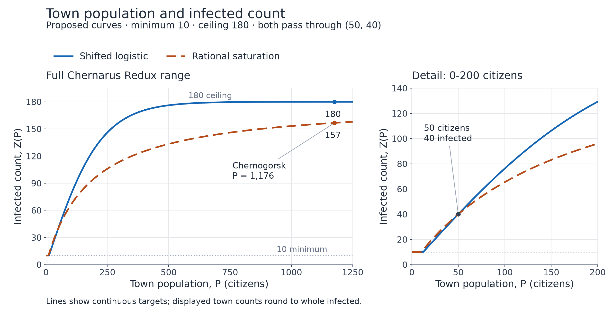
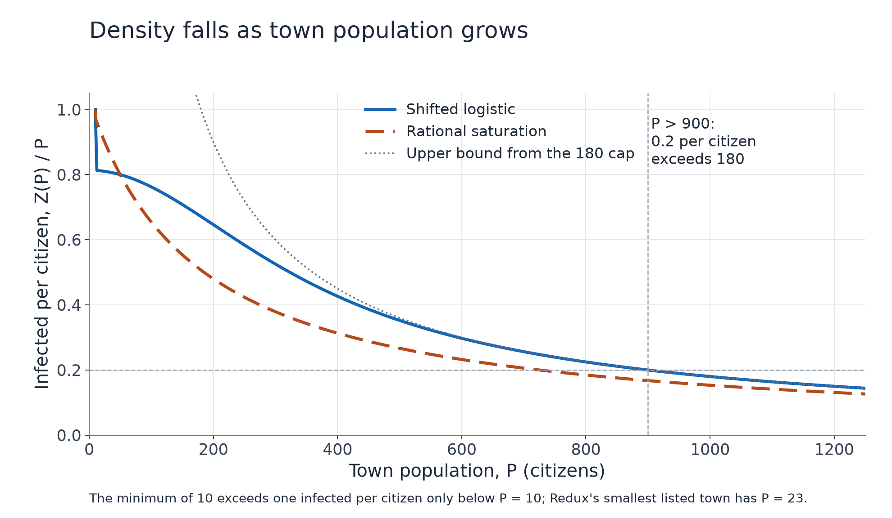

# Proposed infected population curves

14 November 2026. Mathematical design comparison requested by the product owner;
neither curve is selected or applied to gameplay. The request supersedes the
earlier fixed one-in-three design target. Infected-held ownership and per-visit
regeneration remain requirements; neighborhood versus whole-town activation is
still undecided.

The owner requested approximately 0.6-1.0 infected per citizen in small towns,
declining toward approximately 0.2-0.5 in larger towns, with a minimum near 10 and
a ceiling no greater than approximately 180. This comparison uses a ceiling of
180. It is a population target, not a measured safe number of simultaneous actors.

## Calibration and source

Let P be Ultimate's configured town population and Z(P) the continuous infected
target. Both proposals use the same design calibration:

- Minimum target: 10 infected.
- Upper asymptote: M = 180 infected.
- At P = 50 citizens, Z = 40 infected, or 0.8 per citizen.

The (50, 40) calibration is a proposed tuning choice in the middle of the requested
small-town density range. It is not an observed playtest result or an owner-supplied
data point. The owner has not specified numerical boundaries between small and
large towns, so these models show the tradeoff rather than assuming those boundaries.

The examples use all 49 entries from Ultimate's pinned
[Chernarus Redux population configuration](https://github.com/Antistasi-Ultimate-Community/A3-Antistasi-Ultimate/blob/c7c8247672ed5e7d4aa317d47efb371c41de4e7d/A3A/addons/maps/Antistasi_chernarusredux.chernarusredux/mapInfo.hpp).
They range from 23 in Olsha to 1,176 in Chernogorsk. These are configured game
populations, not census data. `getCityData` places population in index 0 of
`A3A_townData`; it does not use the civilian vehicle count or support values.
The extracted inputs and their exact source SHA-256 are in
[the population CSV](town-density/chernarus-redux-populations.csv) and
[source record](town-density/population-source.json).

## 1. Shifted logistic

Start with the logistic function S(x) = 1 / (1 + exp(-x)). To make infected counts
increase at a declining rate for positive population, place the inflection point
at P = 0 and use only the concave half. Shift and scale it so the unfloored target
starts at zero and approaches M:

```math
f_L(P) = 2M\left[S(kP)-\frac12\right]
       = \frac{2M}{1+e^{-kP}}-M
       = M\tanh\left(\frac{kP}{2}\right).
```

Impose the common calibration with M = 180:

```math
40 = \frac{360}{1+e^{-50k}}-180
\quad\Longrightarrow\quad e^{-50k}=\frac7{11}
\quad\Longrightarrow\quad k=\frac{\ln(11/7)}{50}
\approx 0.009039702475.
```

The proposed target is therefore:

```math
\boxed{Z_L(P)=\max\left(10,\frac{360}{1+e^{-0.009039702475P}}-180\right)}.
```

The floor applies until approximately P = 12.304. Above the floor, the curve
initially has a marginal rate near 0.814 infected per additional citizen, then
flattens toward 180. It remains relatively dense through medium populations:
Z(200) is approximately 129.3, or 0.646 per citizen. Its density enters the
0.2-0.5 interval at approximately P = 323.2 and leaves it near P = 899.5.

This is a floor-clipped, shifted logistic curve. Using its positive, concave half
is intentional: an unshifted S-curve could initially increase density with
population, contrary to the requested relationship.

## 2. Rational saturation

A non-logistic alternative is a rectangular hyperbola:

```math
f_R(P)=\frac{MP}{P+H},\qquad M=180.
```

The denominator makes the infected-per-citizen ratio decrease smoothly. The same
calibration determines H:

```math
40=\frac{180\cdot50}{50+H}
\quad\Longrightarrow\quad H=175.
```

The proposed target is:

```math
\boxed{Z_R(P)=\max\left(10,\frac{180P}{P+175}\right)}.
```

The floor applies until approximately P = 10.294. Above the floor its density is
particularly transparent:

```math
\frac{Z_R(P)}P=\frac{180}{P+175}.
```

It gives 0.8 per citizen at P = 50, approximately 0.655 at P = 100, 0.48 at
P = 200, and approximately 0.332 at P = 367. It stays in the 0.2-0.5 density
interval from P = 185 through P = 725. It approaches 180 more gradually than
the logistic model, preserving more count differences between large cities.

## Plots and town examples



Both curves are continuous design targets. A future implementation would round
to the nearest whole infected, with positive halves rounded upward, bounded to
10-180. The table shows those rounded counts and their resulting ratios; the CSV
also retains unrounded targets and densities.

| Town | Population P | Logistic: infected (per citizen) | Rational: infected (per citizen) |
| --- | ---: | ---: | ---: |
| Olsha | 23 | 19 (0.83) | 21 (0.91) |
| Tulga | 46 | 37 (0.80) | 37 (0.80) |
| Dubrovka | 100 | 76 (0.76) | 65 (0.65) |
| Pavlovo | 166 | 114 (0.69) | 88 (0.53) |
| Zelenogorsk | 367 | 167 (0.46) | 122 (0.33) |
| Elektrozavodsk | 603 | 178 (0.30) | 140 (0.23) |
| Chernogorsk | 1,176 | 180 (0.15) | 157 (0.13) |

[All 49 town results](town-density/town-density-comparison.csv),
[vector count plot](town-density/town-density-curves.svg), and
[vector density plot](town-density/town-density-ratios.svg).



## Bounds and recommendation

Both unfloored functions are increasing and concave for positive P, and both
start at zero. Their ratios f(P)/P therefore decrease as P grows. Applying the
floor replaces the ratio by max(10/P, f(P)/P), still decreasing. Their targets
never exceed 180. Rounding may introduce small steps in the actual ratio.

There are two unavoidable boundary effects:

- A 180 cap means Z/P <= 180/P. At P > 900, even the maximum is below 0.2 per
  citizen. Chernogorsk's maximum density is 180/1176, approximately 0.153.
  No curve can meet both the 180 cap and a 0.2 lower bound there.
- A minimum of 10 implies more than one infected per citizen when 0 < P < 10.
  The smallest town in the current Redux table has 23 citizens, so this does
  not affect those 49 examples. A zero or invalid population's gameplay
  eligibility is not decided by this mathematical comparison.

Recommendation: prefer the rational curve if the priority is reducing density
earlier as towns grow. Prefer the shifted logistic if medium towns should remain
crowded and major cities should be close to 180. On the supplied qualitative
requirements, the rational curve is the closer starting proposal; actual town
fullness and performance remain playtest questions.

## Reproduction and validation

`Tools/dev/plot-town-density.py` reproduces both PNG/SVG plots, all town results,
and [the parameter/check record](town-density/model-parameters.json). It uses
Python and matplotlib; the recorded run used matplotlib 3.11.2, installed only
under the ignored project tooling directory.

Eleven mathematical checks passed, including bounds, monotonic counts,
decreasing continuous density, the shared calibration, whole-number bounds,
and equivalence of the logistic and tanh forms. The numerical grid covers
P = 0 to 10,000 in 0.1 increments. These checks support the derivation; they do
not constitute Arma performance or campaign testing. Both rendered plots were
visually inspected. No Computer Use was performed.
